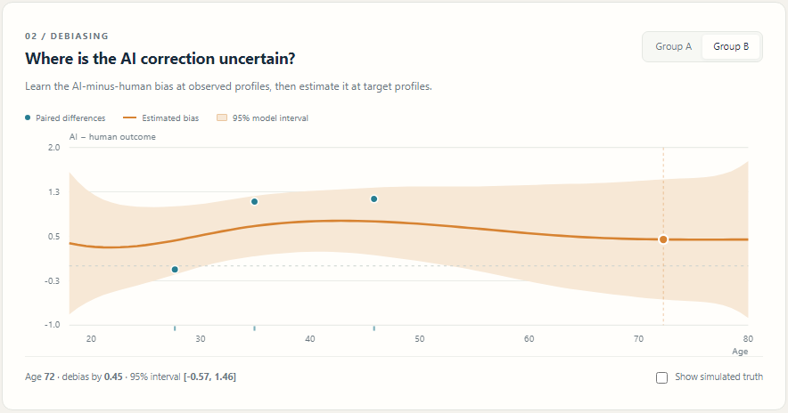

# Human–AI Survey Design

**Survey Design Lab** is an interactive research demo for designing survey samples with human and AI respondents. Given a target population and a human sample with demographic gaps, choose which target profiles to use for AI respondents and how much each human or debiased AI answer should contribute.

The design minimizes model-based **response risk** subject to a **representational-risk** tolerance and an AI generation budget. The two risks are kept separate. The application runs locally; it needs no API key, LLM service, web framework, or remote assets.

**[Download the Windows app](https://github.com/CleverPaul/human-ai-survey-design/releases/download/v0.1.0/SurveyDesignLab.exe)** · **[Portable ZIP](https://github.com/CleverPaul/human-ai-survey-design/releases/download/v0.1.0/SurveyDesignLab-portable.zip)** · **[All release files](https://github.com/CleverPaul/human-ai-survey-design/releases/tag/v0.1.0)**

Windows x64 · No Python installation · No Gurobi license · Offline computation


## Explore the two risks

AI respondents can improve demographic coverage where their response bias is difficult to learn. The demo lets you inspect that trade-off and decide how much AI data should count.

**Bias and uncertainty.** Compare paired human–AI answers, inspect the fitted bias, and move across age to see the debiasing value and its model-based interval.



**Sample design.** Set the AI budget and allowed demographic distance, solve for selected profiles and contribution weights, and compare the resulting risk frontier.


## Windows desktop: double-click to run

Download `SurveyDesignLab.exe` from the [release page](https://github.com/CleverPaul/human-ai-survey-design/releases/tag/v0.1.0) and double-click it (Windows x64, approximately 241 MB).
It includes Python, the numeric libraries, a Qt desktop window, and the
license-free SCIP solver. No Python installation, Gurobi license, internet
connection, or external browser is needed. Double-click the executable;
use **Download run** to save results through the normal Windows save dialog.

An alternative is `SurveyDesignLab-portable.zip`: extract the whole
folder and double-click `SurveyDesignLab/SurveyDesignLab.exe`. Keep the
`_internal` folder beside this executable. The folder version avoids
unpacking the runtime at every launch; the single-file executable extracts
its bundled runtime to a temporary directory before opening.
See the [desktop guide](docs/桌面版使用说明.md) and [build instructions](desktop/BUILD.md).
The executable loads bundled interface files through QtWebEngine and calls
Python through QWebChannel; it does not start a local HTTP server.

The Windows executable does not run on macOS. Mac and Linux users can run the
Python/browser version below. A hosted browser demo is not yet available.

## Run from Python

Python 3.10 or later is required. Create a virtual environment, activate it,
and install the demo dependencies:

```bash
python -m venv .venv
# Activate .venv using your platform's normal command.
python -m pip install -r requirements-demo.txt
python app.py
```

Open **http://127.0.0.1:8765** in your browser. Stop the process with Ctrl+C.
To use another port: `python app.py --port 8766`.

`requirements-demo.txt` installs the license-free SCIP backend. Alternatively,
`requirements-core.txt` supplies only NumPy/SciPy and the HiGHS fallback;
`requirements.txt` installs Gurobi for the reference experiments. Automatic
selection tries Gurobi, then SCIP if installed, then HiGHS. Each backend
reports bounds and its actual gap; a time-limited solution is not presented
as optimal.

## Try it

1. Start with seed **42**, human coverage **45%**, **12** human respondents, AI budget **3**, and distance tolerance **0.080**.
2. Switch to **Group B**. Move or drag across the bias chart to inspect the debiasing value and its model-based interval at an age. Blue points are observed paired AI-minus-human differences; the band concerns bias uncertainty, not the spread of future individual answers.
3. Change the AI budget or distance tolerance, then click **Optimize the design**. Changing human coverage or human sample size generates and refits the scenario. Budget/tolerance changes keep the fitted model fixed.
4. Compare **Age**, **Group**, and individual **Weights**. The number of generated respondents and their total contribution weight are different decisions.
5. Set budget to **0**. At tolerance **0.080** the default problem is infeasible; at **0.250** a human-only solution is feasible.
6. Expand the trade-off panel to solve the same model at several tolerances. Download the run to inspect the profiles, corrections, joint matrices, solution, and solver diagnostics.

The optional truth overlay is for simulation assessment. Truth is never used to fit the bias model or select profiles/weights. Broader human coverage changes which people are available; it does not create a nested sequence of human datasets, so no monotonic improvement is promised for that slider.

## What is actually implemented

- **Target:** eight equally weighted candidate profiles, spanning continuous age and two illustrative groups. Human ages are continuous and differ from target ages.
- **Debiasing:** paired simulation at human profiles, followed by a **Bayesian cubic-spline/GAM with group-specific curves**. This runnable prototype uses a spline model, **not BART**. It supplies joint bias uncertainty across profiles.
- **Response risk:** the complete conditional second moment `Q = E[e eᵀ]`, including uncertainty in debiasing, response variation, nonzero conditional human means, and dependence from reusing humans for calibration. Fresh AI noise is included once.
- **Decisions:** binary target-profile selection plus nonnegative human and AI contribution weights summing to one. One fresh AI answer per selected profile; unit costs; no replication optimization in this prototype.
- **Representation:** finite-cost Wasserstein distance under `|normalized_age difference| + 0.5 × group mismatch`. Cross-group transport is allowed. This is the paper's mixed-feature formulation; it does not silently impose exact group quotas.
- **Solver:** a convex MIQP with a quadratic objective and linear constraints. Default size: **188 variables**, including transport and selection variables. Gurobi solves it directly; SCIP uses an equivalent quadratic epigraph (189 variables, one convex quadratic constraint). The optional HiGHS backend uses supporting cuts for the convex objective and reports bounds. The desktop release uses SCIP.

Details and the mapping to the appendix are in [docs/method.md](docs/method.md).

## Reproduce the solved example

```bash
python -m siliconsurvey.run_example
python -m unittest discover -s tests -v
python tools/verify_model.py
```

The first command regenerates [results/demo.json](results/demo.json), [summary.csv](results/summary.csv), and [frontier.csv](results/frontier.csv). It explicitly uses Gurobi. The last command independently checks Gaussian conditioning, the MSE bounds, and human-only transport limits, writing `results/independent_checks.json`. The CLI permits other scenarios and solvers:

```bash
python -m siliconsurvey --budget 3 --tolerance .08 --backend gurobi \
  --output results/local_run.json --scenario-output results/local_scenario.json --matrices
```

Use one line in PowerShell. For a license-free run, install PySCIPOpt and use
`--backend scip`, or use `--backend highs --time-limit 30` with the core dependencies alone.

Seed 42 was **actually solved** with Gurobi 13.0.2; all feasible frontier points had reported gap zero:

| Design | Demographic distance | Response risk | Estimate |
|---|---:|---:|---:|
| Unweighted human sample | 0.310904 | 0.010199 | 3.546418 |
| Human-only, any nonnegative weights | minimum 0.152893 | infeasible at ε = 0.08 | — |
| Designed human + AI sample | 0.080000 | 0.021538 | 3.687723 |

Selected target indices are **3, 5, 7** (zero-based), with **24.19%** of total estimate weight assigned to AI. The simulated target mean is **3.675**. The designed sample improves demographic matching while accepting higher response risk than the unweighted human sample. Its smaller realized estimation error in this example is a single-run result, not a general performance guarantee.

## Gurobi licensing

The installed package includes a legitimate size-limited license. Its quadratic-model limit is **200 variables**; the default 188-variable instance fits. No license file or credentials are included in this repository. The code selects an installed license by path without reading or modifying its contents.

`SURVEY_GUROBI_LICENSE` can be `auto` (default, prefers the bundled license), `bundled`, or `configured`. For a full academic/commercial license and larger instances, set `configured` **before starting a fresh Python process**:

```powershell
$env:SURVEY_GUROBI_LICENSE = 'configured'
python -m siliconsurvey --humans 30 --targets 20 --backend gurobi
```

The configured mode respects the normal Gurobi license setup. Auto mode falls back to SCIP (if installed) or HiGHS when Gurobi cannot solve. A larger model is not claimed to work under the small-model license. See Gurobi's [license limits](https://support.gurobi.com/hc/en-us/articles/360051597492-How-do-I-resolve-a-Model-too-large-for-size-limited-Gurobi-license-error).

## Scope and limitations

This is a reproducible **synthetic prototype**, not a completed empirical validation. Noise variances are known simulation inputs; spline knots, priors, and the demographic metric are fixed design choices. Model intervals can miss systematic extrapolation error. They are neither distribution-free guarantees nor evidence that BART automatically detects unsupported populations. In applications, these settings require sensitivity checks, held-out demographic regions, and estimated response variances.

One outcome and one generation per target profile are implemented. The eight-point target representation is deliberately small for a fully solved, portable demonstration. The desktop release bundles its Python runtime; the browser version uses a local Python process.

## Licenses

No general reuse license has been assigned to the original research code.
Third-party components retain their own licenses. The desktop release includes
their notices; a separate notices ZIP and SHA256 checksums are available on the
[release page](https://github.com/CleverPaul/human-ai-survey-design/releases/tag/v0.1.0).

## Files

```text
app.py                     local HTTP application
desktop_app.py             standalone desktop window and native bridge
desktop/                   reproducible Windows build and third-party notices
web/                       offline HTML, CSS, SVG charts, interaction
siliconsurvey/             calibration, risk matrix, Gurobi/SCIP/HiGHS, CLI
tests/                     model, optimization, leakage, and HTTP checks
tools/                     independent mathematical verification
results/                   solved seed-42 example and frontier
docs/                      mathematical implementation and preview
requirements*.txt          tested dependencies
run_demo.ps1               optional Windows launcher for the Python version
```

Tests check conditional moments, positive semidefiniteness, truth/fresh-response separation, activation/budget/simplex constraints, independent transport distance, infeasible human-only designs, the fixed-Q frontier, solver bounds, and HTTP validation. Browser interaction and layout were additionally checked using local Chrome; see [docs/validation.md](docs/validation.md).
