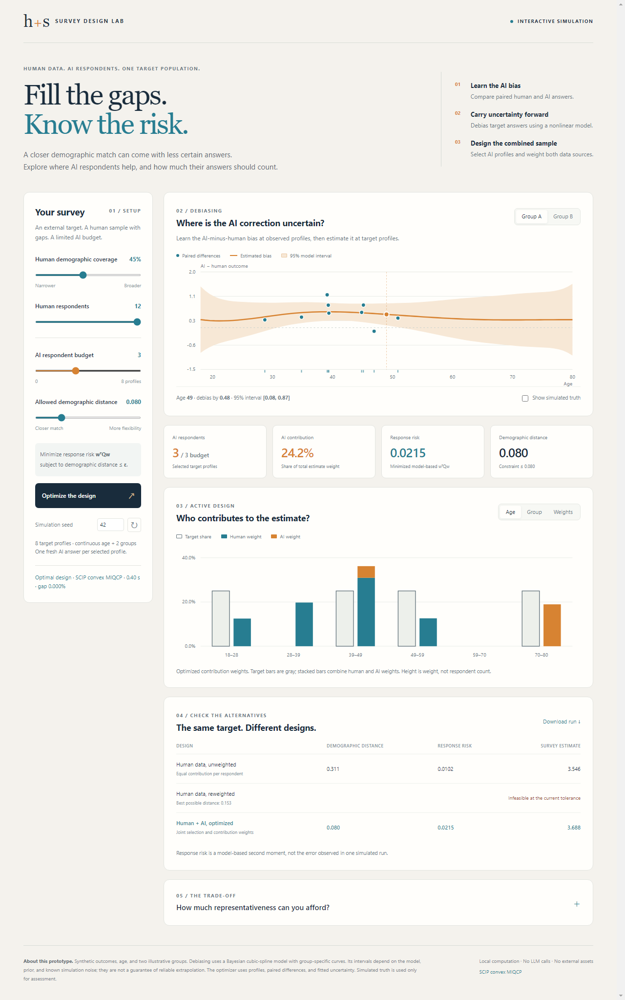
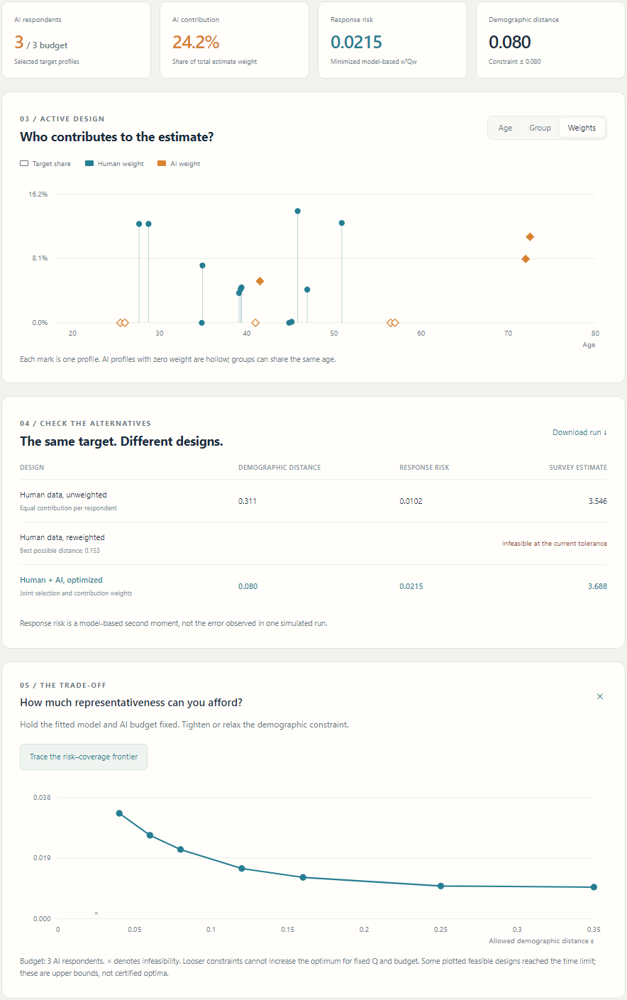

# Human–AI Survey Design

Explore how human and AI respondents can be combined in a survey. Adjust demographic coverage, inspect AI bias, and design the contribution of each response using simulated data.

**[Download the Windows app](https://github.com/CleverPaul/human-ai-survey-design/releases/download/v0.1.0/SurveyDesignLab.exe)** · [Portable ZIP](https://github.com/CleverPaul/human-ai-survey-design/releases/download/v0.1.0/SurveyDesignLab-portable.zip)

Windows 64-bit. Double-click `SurveyDesignLab.exe` to start.

## Bias and uncertainty

See how estimated AI bias and debiasing uncertainty vary across demographic profiles.

## Sample design

Set the AI budget and demographic constraint, then compare selected profiles, contribution weights, and the risk frontier.

