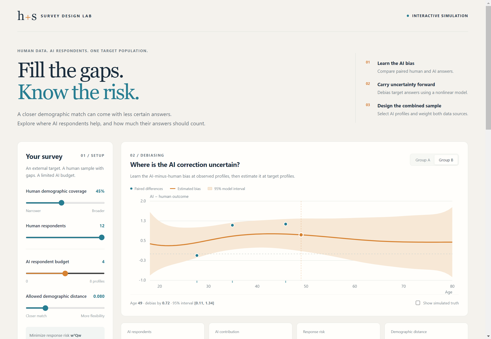

# Desktop release validation

Validated on Windows x64 on 2026-11-01. Both frozen distributions passed the
same real-interface test through QtWebChannel, using the bundled SCIP solver.

| Artifact | Size | Exit code | Frozen-app test |
|---|---:|---:|---|
| `dist/SurveyDesignLab.exe` | 240,868,138 bytes | 0 | Passed |
| `dist/SurveyDesignLab/SurveyDesignLab.exe` | 7,126,442 bytes, plus `_internal` | 0 | Passed |
| `dist/SurveyDesignLab-portable.zip` | 242,279,795 bytes | — | All 2,931 entries passed CRC verification |

For each executable, `desktop/verify_release.py` launched the app from an
empty temporary working directory, removed Python/Conda/Gurobi/Qt environment
variables, and restricted PATH to Windows system directories. The embedded
page loaded from its bundled `file:` URL; no HTTP server or installed browser
was used. A separate clean Windows machine has not yet been tested.

The test verified initial optimization, switching demographic group and
weight views, changing the AI budget and solving again, exporting a JSON
run with the full 20-by-20 risk matrix, and computing eight frontier points.
The first seven frontier points were optimal; the last reached its time
limit and retained its actual status and gap. This was not counted as a
certified optimum. Screenshots were captured by the application itself;
additional OS-level automatic clicks were not permitted by the computer-use
tool.

The default result was identical in both builds: response risk
`0.021538106282502634`, relative gap `4.13e-8`, selected target indices
`[3, 5, 7]`, and AI contribution `0.2419095324`. Its objective differs from
the Gurobi reference by approximately `7.1e-9`.

The static bundle audit found all eight SCIP dependency DLLs and the
QtWebEngine helper, resources, ICU data, and English locale. No Gurobi
package, Gurobi license, or alternative Qt binding was bundled. The
distribution includes versioned third-party notices and source provenance.

Python regression checks passed in both the research and isolated build
environments: 24 tests each, with six tests skipped where the optional
alternative solver was absent. All nine JavaScript bridge tests passed.

Versions, artifact hashes, and summarized runtime checks are recorded in
[desktop_release_checks.json](desktop_release_checks.json). Rebuild and
verification commands are in [desktop/BUILD.md](../desktop/BUILD.md).

